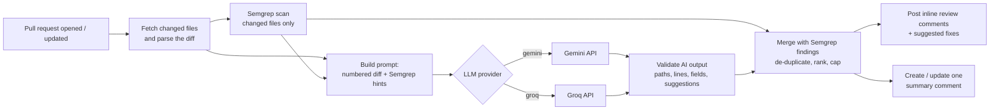

# 🛡️ PR Guardian

**AI-assisted, security-aware code review for every pull request.**
PR Guardian is a GitHub Action that combines **Semgrep** static analysis with an **LLM (Google Gemini or Groq)** to review the changed lines of a pull request, then posts inline comments with **one-click suggested fixes**.

It is built to run entirely on free tiers: GitHub Actions, Semgrep Community Edition, and a free Gemini or Groq API key.

---

## How it works



1. **Collect the diff.** Changed files are fetched from the GitHub API. Lockfiles, build output, minified and binary files are skipped. Each patch is parsed into exact new-file line numbers.
2. **Static analysis.** Semgrep Community Edition scans only the changed files. Only findings on lines added in this PR are kept.
3. **LLM review.** The diff is sent with explicit line numbers plus Semgrep's findings as hints. Large PRs are split into several requests. The model must reply in a fixed JSON format.
4. **Validate the AI output.** Every comment is checked against the real diff. Unknown files, lines outside the diff, malformed fields and unsafe suggestions are discarded. The model's answer is never trusted blindly.
5. **Merge and rank.** If Semgrep and the LLM flag the same line, they become one comment that credits both. Findings are filtered by severity, de-duplicated, sorted worst-first and capped.
6. **Post.** Inline comments go out as a single review, with GitHub `suggestion` blocks for small, safe fixes. A single summary comment is created and then updated on later runs. Comments already posted in an earlier run are not repeated.

## Features

- **Two LLM providers, one setting:** `llm-provider: gemini` or `llm-provider: groq`, with any model ID you choose.
- **Semgrep + AI together:** rules catch known patterns reliably; the LLM adds context, explanations and fixes.
- **One-click suggested fixes** using GitHub's "Apply suggestion" button. Single-line and multi-line ranges are supported.
- **Validated AI output:** comments only land on real diff lines, and malformed or out-of-range output is dropped and logged.
- **No duplicate noise:** a hidden fingerprint on each comment prevents re-posting on every push, and the summary comment is updated in place.
- **Handles large PRs:** diffs are split into size-limited requests, with per-file and per-run limits.
- **Resilient:** retries on rate limits (429) and server errors with backoff and `Retry-After` support. If the LLM fails, Semgrep results are still posted.
- **Configurable:** severity threshold, comment cap, ignored paths, Semgrep rulesets, suggestions on or off.

## Quick start (about 5 minutes, free)

### 1. Get a free API key (pick one)

| Provider | Where to get a key | Secret name to use |
| --- | --- | --- |
| Google Gemini | [Google AI Studio](https://aistudio.google.com/apikey) → *Create API key* | `GEMINI_API_KEY` |
| Groq | [GroqCloud console](https://console.groq.com/keys) → *Create API Key* | `GROQ_API_KEY` |

Free-tier rate limits change over time; check your provider's dashboard. Note that Google may use free-tier Gemini prompts to improve its products, so prefer Groq or a paid tier for private or sensitive code.

### 2. Add the key as a repository secret

In your repository, go to **Settings → Secrets and variables → Actions → New repository secret** and add the secret name from the table above.

### 3. Add the workflow

Create `.github/workflows/pr-guardian.yml`:

```yaml
name: PR Guardian
on:
  pull_request:
    types: [opened, synchronize, reopened, ready_for_review]

permissions:
  contents: read
  pull-requests: write

jobs:
  review:
    if: github.event.pull_request.draft == false
    runs-on: ubuntu-latest
    steps:
      - uses: actions/checkout@v7
        with:
          ref: ${{ github.event.pull_request.head.sha }}
          persist-credentials: false
      - uses: DaraSingh45/PR_Guardian@v1
        with:
          llm-provider: gemini                     # or: groq
          api-key: ${{ secrets.GEMINI_API_KEY }}   # or: ${{ secrets.GROQ_API_KEY }}
```

A fuller example with every option is in [`examples/pr-guardian.yml`](examples/pr-guardian.yml).

### 4. Open a pull request

Try a small change like this in a test branch and open a PR:

```ts
const API_KEY = "sk_live_example_not_a_real_key";

export async function getUser(db: any, id: string) {
  return db.query(`SELECT * FROM users WHERE id = ${id}`);
}
```

PR Guardian should flag the hardcoded secret and the SQL injection, each with a suggested fix.

## Inputs

| Input | Default | Description |
| --- | --- | --- |
| `llm-provider` | `gemini` | `gemini` or `groq` |
| `api-key` | *(required)* | API key for the chosen provider, passed from a secret |
| `model` | provider default | Model ID. Defaults: `gemini-3.5-flash-lite` (Gemini), `openai/gpt-oss-120b` (Groq). Any model your key can access works, e.g. `gemini-3.5-flash` or `llama-3.3-70b-versatile`. |
| `github-token` | `${{ github.token }}` | Token used to read the PR and post comments |
| `enable-semgrep` | `true` | Run Semgrep on the changed files |
| `semgrep-config` | `p/default` | Semgrep rulesets or a path to your own rules; comma-separated, e.g. `p/default,p/secrets,p/owasp-top-ten` |
| `suggestions` | `true` | Include one-click suggested fixes |
| `min-severity` | `low` | Lowest severity to post: `low`, `medium`, `high`, `critical` |
| `max-comments` | `15` | Maximum inline comments per run |
| `max-files` | `30` | Maximum changed files reviewed per run |
| `ignore-paths` | *(empty)* | Extra comma-separated globs to skip, e.g. `docs/**,**/*.md` |
| `max-chars-per-request` | `24000` | Diff size per LLM request; bigger PRs are split |

## Outputs

| Output | Description |
| --- | --- |
| `comments-posted` | New inline comments posted in this run |
| `findings-total` | Findings after validation, before the `max-comments` cap |
| `highest-severity` | `none`, `low`, `medium`, `high` or `critical` |

Example: fail the job on critical findings by adding a step after PR Guardian.

```yaml
      - uses: DaraSingh45/PR_Guardian@v1
        id: guardian
        with:
          api-key: ${{ secrets.GEMINI_API_KEY }}
      - if: steps.guardian.outputs.highest-severity == 'critical'
        run: |
          echo "::error::PR Guardian found a critical issue."
          exit 1
```

## Security design

- **Least privilege.** The workflow asks only for `contents: read` and `pull-requests: write`. Checkout uses `persist-credentials: false`.
- **Prompt-injection resistant.** The diff and PR description are wrapped in tags and marked as untrusted data. The model is told never to follow instructions inside them. Its output can only become comments that pass validation, and it can never trigger actions.
- **Output validation.** File paths, line numbers, severities and categories are checked against the real diff and allowed values. Suggestions containing code fences, oversized suggestions and no-op suggestions are dropped. `@mentions` are neutralised so a model cannot ping people.
- **Secrets handling.** The API key is masked in logs and sent in a request header, not in the URL.
- **Fork-safe.** Runs on `pull_request`, not `pull_request_target`, so code from forks never runs with write access or secrets. For fork PRs, where secrets are unavailable, the action skips with a notice instead of failing.
- **Human in the loop.** Every AI comment is labelled as AI-generated. Fixes are suggestions the author applies, never automatic commits.

## Project structure

```
PR_Guardian/
├── action.yml              # Action metadata: inputs, outputs, node24 runtime
├── src/
│   ├── main.ts             # Orchestration: fetch → scan → review → validate → post
│   ├── diff.ts             # Patch parsing, line mapping, ignore globs, batching
│   ├── semgrep.ts          # Install and run Semgrep CE, filter to changed lines
│   ├── prompt.ts           # System prompt and per-batch user prompt
│   ├── validate.ts         # JSON extraction, output validation, merging, ranking
│   ├── review.ts           # Comment and summary formatting, fingerprints
│   ├── types.ts
│   └── providers/
│       ├── index.ts        # Provider factory and defaults
│       ├── gemini.ts       # Google Gemini (generateContent, JSON mode)
│       ├── groq.ts         # Groq (OpenAI-compatible chat completions, JSON mode)
│       └── http.ts         # Fetch with retries, backoff and Retry-After
├── test/                   # Vitest unit tests
├── dist/index.js           # Bundled action (committed; GitHub runs this file)
├── examples/pr-guardian.yml
└── .github/workflows/      # CI (tests + dist check) and self-review
```

## Local development

Requires Node.js 24.

```bash
npm ci
npm run typecheck   # TypeScript checks
npm test            # unit tests (diff parsing, validation, providers, formatting)
npm run build       # bundle to dist/index.js with esbuild
```

Commit `dist/` after every change to `src/`; the CI workflow fails if it is out of date.

### Publishing a release

```bash
git tag -a v1.0.0 -m "PR Guardian v1.0.0"
git tag -f v1                # moving major tag that users reference
git push origin v1.0.0 v1 --force
```

Optionally publish it to the GitHub Marketplace from the release page.

## Limitations

- Reviews the diff only, so it has limited context about code elsewhere in the repository.
- LLM findings can be wrong; treat them as review suggestions, not verdicts.
- Free-tier rate limits can be hit on very large PRs. Lower `max-files` or raise `max-chars-per-request` to send fewer requests.
- Line-level suggestions cannot express changes that span several files.

## License

[MIT](LICENSE) © Dara Singh
